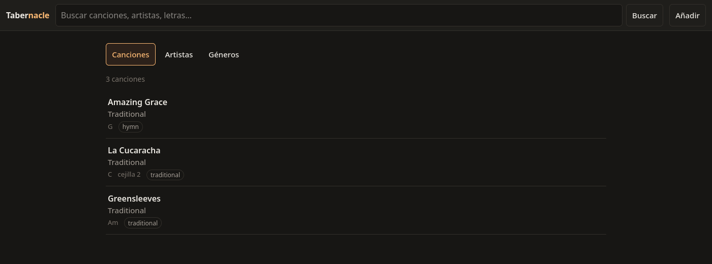
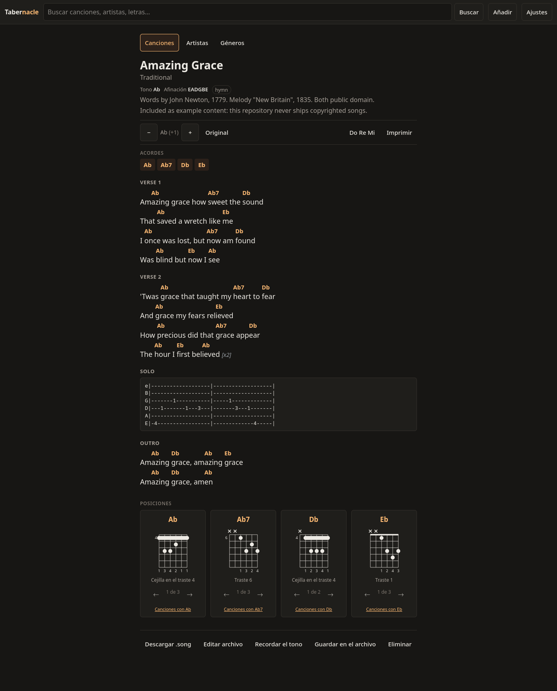
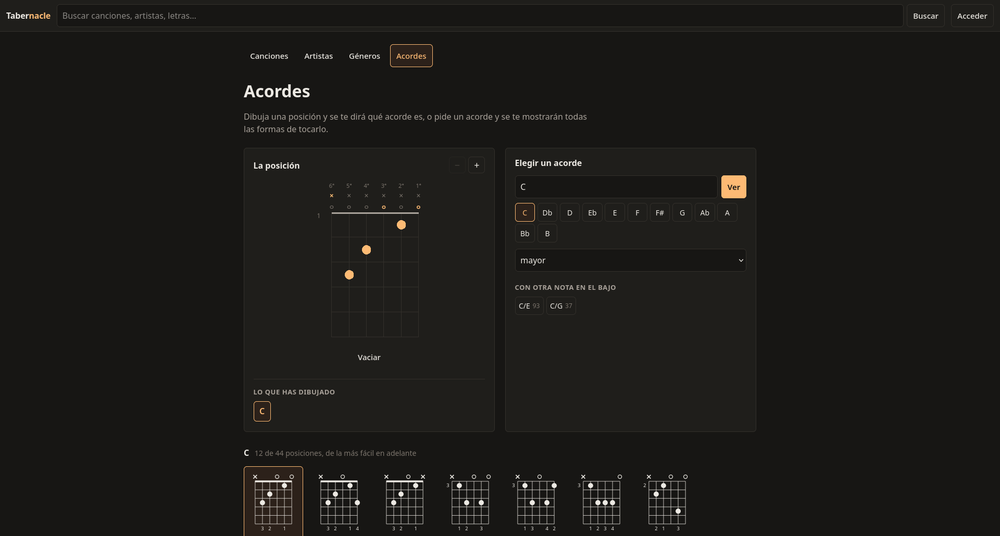

# Tabernacle

[](https://github.com/jalmena/tabernacle/actions/workflows/ci.yml) [](https://github.com/jalmena/tabernacle/releases) [](https://goreportcard.com/report/github.com/jalmena/tabernacle) [](go.mod) [](LICENSE) [](https://github.com/jalmena/tabernacle/pkgs/container/tabernacle)

**Your sacred repository of guitar tabs.**

A self-hosted guitar songbook. Your songs are plain `.song` text files in a directory you own — back
them up, edit them by hand, put them in git. Single binary or single container, works offline, no
telemetry. Reading needs no account; changing anything does.

> **Status:** young. Everything documented here works and is tested.

## Features

| | |
| --- | --- |
| **Search** | full text over titles, artists and lyrics; accent- and case-insensitive |
| **Transpose** | chords and tablature together, clamped at either end of the neck |
| **Chord diagrams** | curated and movable shapes, with alternative voicings |
| **Chord reference** | draw a shape and be told what it is, or see every way to play a chord |
| **Simplify** | rewrites a sheet's unplayable chords into ones you can hold |
| **Note names** | `C D E` or `Do Re Mi` |
| **Capo advice** | where to clamp so a barred song becomes open chords, for the same sound |
| **Play mode** | the sheet scrolls itself at the pace you set, big enough to read from a stand, screen kept awake |
| **Print** | A4, light paper themes, no interface on the page |
| **Authoring** | paste a song in, or edit the file directly |
| **Songbook** | pick any set of songs and print them as one document |
| **Accounts** | optional; two roles, and reading stays public |
| **Language** | 19 languages, per person; right-to-left where it belongs |

Interface in any of 19 languages, chosen per account. Note names are a separate
setting and switch either way — see [docs/languages.md](docs/languages.md).

## Screenshots

The library:



A sheet transposed up a semitone, with the chord shapes below:



The chord section: draw a shape and it is named, or name a chord and see every
way to play it, easiest first.



## Deployment

```sh
git clone https://github.com/jalmena/tabernacle.git
cd tabernacle
docker compose up -d          # http://localhost:8080, songs in ./data/songs
```

Set `PUID`/`PGID` in `compose.yaml` to whoever owns the data directory (`id -u`, `id -g`). On a NAS
that is usually the difference between a working install and a permissions error.

Images are published for `linux/amd64` and `linux/arm64`.

| Platform | How |
| --- | --- |
| CasaOS / ZimaOS | App Store → **Add Source** → paste the [store](https://github.com/jalmena/tabernacle-appstore) URL, then install Tabernacle like any other app. Custom Install with [`compose.yaml`](compose.yaml) still works. |
| Portainer | Stacks → Add stack → Web editor → paste [`compose.yaml`](compose.yaml) |
| Unraid / Synology | container from `ghcr.io/jalmena/tabernacle:latest`, `/data` on a share |
| From source | Go 1.25+ — `go build ./cmd/tabernacle` |

**Access.** Reading is public: anyone who reaches the port can browse, search and print. Changing
anything needs an account, once you have made one — press **Acceder** on a fresh instance and claim
it, or set `TABERNACLE_ADMIN_USER` and `TABERNACLE_ADMIN_PASSWORD` on first run. Until it is claimed
it behaves as it always did, with a banner saying so. Two roles: everyone may edit songs, an
administrator also manages accounts. See [docs/accounts.md](docs/accounts.md).

Requests are refused unless the `Host` matches a private name or address, which stops DNS
rebinding; set `TABERNACLE_ALLOWED_HOSTS` if you front it with a domain.

## Configuration

Environment variables, all with defaults. Invalid values fail at startup and report every problem at
once, naming the variable.

| Variable | Default | |
| --- | --- | --- |
| `TABERNACLE_ADDR` | `:8080` | Listen address |
| `TABERNACLE_DATA_DIR` | `/data` | Base for songs, trash and index |
| `TABERNACLE_SONGS_DIR` | `$DATA_DIR/songs` | The collection |
| `TABERNACLE_TRASH_DIR` | `$DATA_DIR/trash` | Deleted songs land here |
| `TABERNACLE_DB_PATH` | `$DATA_DIR/index.db` | Search index; safe to delete |
| `TABERNACLE_ACCOUNTS_FILE` | `accounts.json` | Accounts, inside `$DATA_DIR`; **back this up** |
| `TABERNACLE_ADMIN_USER` | — | Creates or resets this administrator at startup |
| `TABERNACLE_ADMIN_PASSWORD` | — | Its password; read once, never stored |
| `TABERNACLE_BASE_URL` | `http://localhost:8080` | Canonical URL; seeds the host allowlist |
| `TABERNACLE_ALLOWED_HOSTS` | *LAN policy* | Comma-separated hostnames to accept |
| `TABERNACLE_SCAN_INTERVAL` | `60s` | Rescan period; `0` disables |
| `TABERNACLE_NOTATION` | `english` | `english` or `solfege` |
| `TABERNACLE_LANG` | `es` | Interface language for anyone who has not chosen one |
| `TABERNACLE_READ_ONLY` | `false` | Refuse every modification |
| `TABERNACLE_MAX_SONG_BYTES` | `1048576` | Cap on one `.song` file |
| `TABERNACLE_MAX_UPLOAD_BYTES` | `33554432` | Cap on one upload |
| `TABERNACLE_LOG_LEVEL` | `info` | `debug`, `info`, `warn`, `error` |
| `PUID` / `PGID` | `1000` | Container: owner of the data directory |
| `TZ` | UTC | Container: time zone |

## Data

```
data/
  songs/                  the collection — the only thing that matters
    Traditional/Amazing Grace.song
  trash/                  deleted songs, kept rather than erased
  accounts.json           accounts and the session key — the one file that cannot be rebuilt
  index.db                search index — derived, disposable
```

The files are the source of truth. Delete `index.db` and it rebuilds on the next start, with the
same URLs. Back up `songs/` and `accounts.json`. Edit songs in any text editor while Tabernacle
runs; it notices within a minute, or at once if you press Reindex.

## The `.song` format

```
---
title: Amazing Grace
artist: Traditional
key: G
capo: 2
---

## Verse 1
A[G]mazing grace how [G7]sweet the [C]sound
```

Full reference: [docs/song-format.md](docs/song-format.md). Also
[chord diagrams](docs/chord-diagrams.md), [printing](docs/printing.md),
[accounts](docs/accounts.md), [play mode](docs/play-mode.md),
[deployment](docs/deployment.md).

## Architecture

Layers depend strictly downwards, so the musical domain never learns about HTTP, HTML or SQL.

```
cmd/tabernacle          flags, version
  internal/app          wiring: store, index, accounts, library, handler
    internal/web        handlers, middleware, embedded templates and assets
      internal/render   Song -> view model        (no HTTP, SQL or filesystem)
        internal/diagram  shape -> SVG            (standard library only)
        internal/voicing  chord -> playable shapes
          internal/harmony  symbol -> quality, intervals, simplification
      internal/account  who may change the collection  (no HTTP)
      internal/library  use cases; keeps files and index consistent
        internal/songfs   the songs directory: confinement, scan, atomic writes
        internal/index    SQLite: migrations, search, state
          internal/song   the .song format: parse and serialise
            internal/chord  notes, chords, transposition
    internal/config     environment -> configuration
```

| Property | Consequence |
| --- | --- |
| `chord` and `song` are pure | a file read and written back is byte-identical; saving never churns it |
| `diagram` cannot see chord types | rendering and representation cannot entangle |
| File first, index second | a failed index update is fixed by the next scan; the other order loses data |
| Filesystem via a confined root | traversal is stopped at the syscall, not filtered from strings |

## Copyright and musical content

Tabernacle is software for managing musical content **you** provide.

- It ships no song library and supplies, licenses or distributes no musical work. The few examples
  included are public domain, marked as such.
- Rights in anything you store are entirely separate from this software's licence. Using Tabernacle
  grants you no rights in anyone's music.
- You are responsible for complying with the law that applies to you. Rules on private copying and
  personal use differ considerably between countries.
- It does not scrape Ultimate Guitar, LaCuerda or anywhere else, download copyrighted content, or
  bypass paywalls. There is no import-from-URL feature, on purpose.
- Pull requests adding copyrighted lyrics or tabs will be declined.

Not legal advice.
